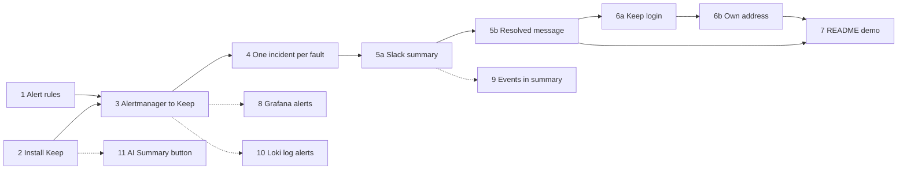

# Story flow for the Keep epic (issue #91)

This page shows the order of the stories and what you can see after each one.
The full text of every story is in `stories.yaml`. The architecture behind the
stories is in `docs/keep/architecture.md`. Terms are explained in
`glossary.md`.

## The idea in one paragraph

Today the stack shows that a fault happened, but nothing happens after an alert
fires. This epic adds the next step. A fault raises several alerts. Keep (an
open-source alert-management tool) groups them into one incident. A language
model writes a short summary, and the summary goes to Slack. When the fault is
fixed, the incident closes by itself and Slack gets one more message.

## Order of the stories

- Solid arrows are the nine main stories. Stories 1 and 2 can run at the same
  time. After that the order is a straight line.
- Dotted arrows are the four lower-priority stories. Do them after story 7.
- Every story can be shown on its own (a demo) and is sized at 1 to 2 days.

## What you can see after each story

| Story | What it adds | Demo you can show | Comes after |
|---|---|---|---|
| 1 | Prometheus alert rules for robot-shop | Start the cart OOM fault. The OOM, restart, unavailable-replica and 5xx alerts fire on the Prometheus Alerts page. Nothing fires for 30 minutes with load and no fault. | nothing |
| 2 | `make setup-keep` installs Keep on AKS | Keep pods are Running. The UI opens through a port-forward. A missing secret stops the command. `make setup-aks` without secrets still finishes. | nothing |
| 3 | Alertmanager (AKS only) sends alerts only to Keep | Run the fault. The alerts appear in Keep and resolve after the revert. | 1, 2 |
| 4 | A correlation rule that groups alerts | One fault gives exactly one incident. It closes by itself. Running `setup-keep` again adds no second rule. | 3 |
| 5a | Providers (Fireworks, Slack) and the "incident opened" workflow | A Fireworks summary appears in Slack within 2 minutes. A reinstall brings everything back with no manual step. | 4 |
| 5b | The "incident resolved" workflow | After the revert, exactly one resolved message appears in Slack. | 5a |
| 6a | Keep login (`AUTH_TYPE=DB`) and checked API keys | You must sign in. A made-up API key is rejected. Alertmanager still delivers. | 3, 4, 5b |
| 6b | Own address `keep.demo.local` on the Istio gateway | The login page opens at the address. New alerts appear without a refresh. | 6a |
| 7 | README section, diagram, screenshots, scenario output | A newcomer follows only the README and reaches the end result. | 5b, 6b |
| 8 | Grafana alerts reach Keep (lower priority) | A Grafana alert shows in Keep with its severity. | 3 |
| 9 | Kubernetes events in the AI summary (lower priority) | The Slack summary names the OOM kill or back-off. | 5a |
| 10 | Loki log alerts reach Keep (lower priority) | A log-based alert caused by the fault shows in Keep. | 3 |
| 11 | Find why the "AI Summary" button fails (lower priority) | A written finding with the cause and a repro. | 2 |

## Rules that apply to every story

- A story is done only after it was shown to work on a real AKS cluster.
- Run `make lint` and paste its output. No secret value in any tracked file.
- Author and approver must be different people. One pull request per story,
  squash-merged.
- The route to Keep (story 6b) never goes live before the login (story 6a).
- Stories 2 to 5b run Keep without a login, reached only through
  `kubectl port-forward`.
- Live checks that the architecture decisions hand to a story:
  - Story 2: image pins, a hook image with a shell, `MYSQL_ROOT_PASSWORD_FILE` on
    the pinned MySQL (AD-013).
  - Story 3: the seeded webhook key and the before-and-after render (AD-009,
    AD-012).
  - Story 6a: the DB login and the real key checks (AD-009).
  - Story 6b: the `/websocket/app/` route (AD-010).
- If a live check fails beyond its fallback, stop and go back to the spec.
