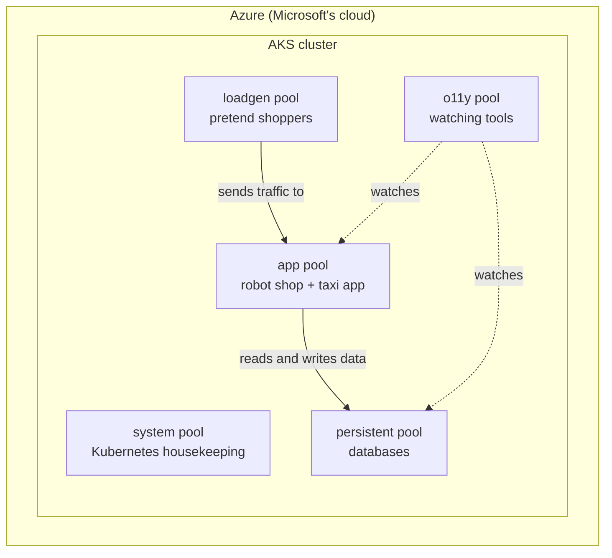
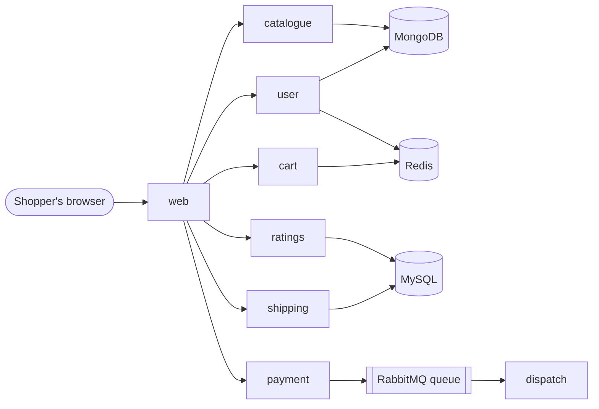
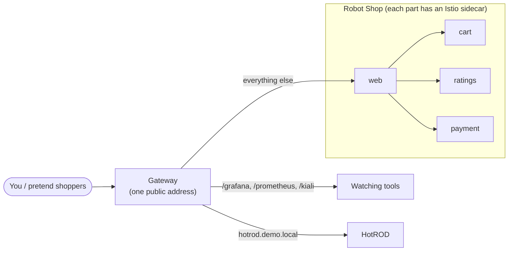
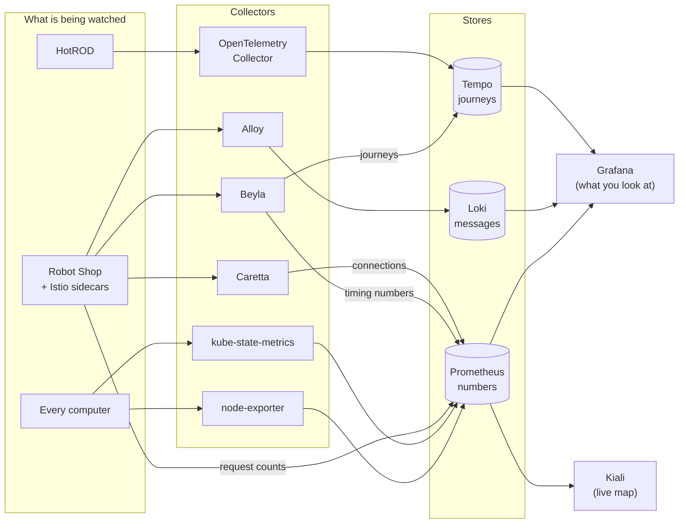
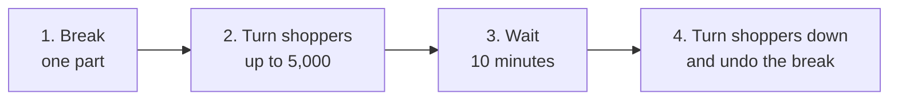
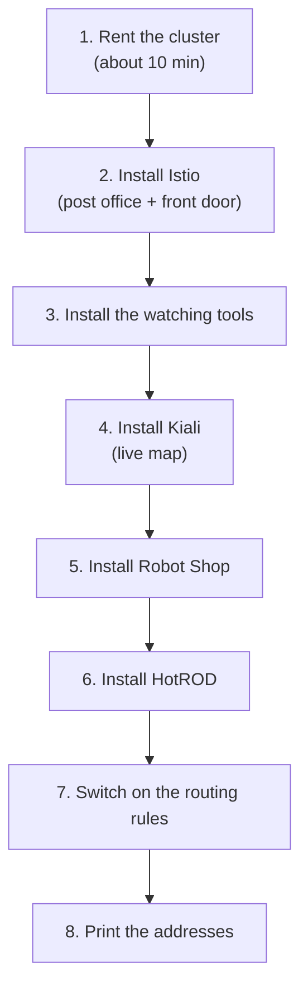

# The SRE Stack on Azure, Explained

## Who this is for

This page is for anyone who wants to know what this project does.
You do not need to know Kubernetes, Azure, or monitoring tools.
Every technical word is explained the first time it appears.

**How to read it.** Each section starts with a short summary in bold.
Read only the summaries for a five-minute overview.
Read the full sections when you want the detail.

**What this page is not.** It is not a setup guide.
It explains what the parts are and why they exist.
The exact commands live in the [README](../README.md).

## 1. What this project is

**In short: it builds a pretend online shop in the cloud, watches it
closely, and then breaks it on purpose, so people can practise finding
and fixing problems.**

Think of a flight simulator. Pilots do not learn to handle an engine
fire on a real flight with passengers. They practise in a simulator,
where mistakes cost nothing. This project is a simulator for the people
who keep websites running.

Those people are often called **SREs** (Site Reliability Engineers).
Their job is to keep a website up, fast, and working. When something
breaks, they find out why and fix it. That skill takes practice, and
real outages are a bad place to learn.

The project does four things, in this order:

1. **Builds a place to run software.** It rents computers from
   Microsoft's cloud, called **Azure**, and joins them into one group
   that runs software together.
2. **Runs two demo applications.** One is an online shop that sells
   robots. The other is a taxi-booking app. Both are free, open-source
   demos made by other teams. Nobody buys anything real.
3. **Installs watching tools.** These tools record how busy each part
   is, what each part says, and how long each request takes. Their
   results show up as charts on a website you can open.
4. **Breaks things on purpose.** A script makes one part fail or slow
   down while pretend shoppers keep using the shop. You then use the
   watching tools to find what went wrong.

Nothing here is a real business. The shop, the shoppers, and the
problems are all made up. The tools and the way you use them are real.

## 2. Words you will meet

**In short: a small dictionary. Skim it now, or come back when a word
in a later section is unclear.**

### Where the software runs

| Word | What it means | Everyday comparison |
|---|---|---|
| **Azure** | Microsoft's cloud. You rent computers there by the hour instead of buying them. | Renting a car instead of owning one. |
| **Container** | A program packed together with everything it needs to run, so it runs the same way on any computer. | A ready meal: open it, heat it, eat it. No shopping for ingredients. |
| **Image** | The saved, ready-to-use copy of a container. Many containers can start from one image. | The recipe card the ready meals are made from. |
| **Kubernetes** | Software that runs many containers across many computers. It decides where each one runs and restarts it if it crashes. Often shortened to **k8s**. | A restaurant manager who assigns cooks to stations and replaces anyone who goes home sick. |
| **Cluster** | The group of computers Kubernetes manages as one. | The whole restaurant kitchen. |
| **AKS** | Azure Kubernetes Service. Azure runs Kubernetes for you, so you only bring your containers. | A kitchen you rent with the manager already hired. |
| **Node** | One computer in the cluster. | One cooking station. |
| **Node pool** | A set of identical nodes kept for one kind of work. This project has five. | The pastry section, the grill section, and so on. |
| **Pod** | The smallest thing Kubernetes runs: one or more containers that live and die together. | One cook at one station. |
| **Namespace** | A named folder inside the cluster that keeps related pods together, for example `robot-shop` or `monitoring`. | Labelled shelves in a shared fridge. |

### How it gets installed

| Word | What it means | Everyday comparison |
|---|---|---|
| **Helm chart** | A ready-made installation package for Kubernetes. One command installs a whole tool with sensible settings. | A flat-pack furniture kit with instructions. |
| **`make` command** | This project's shortcut commands, such as `make setup-aks`. Each one runs a list of steps in the right order. | A "start" button that runs a whole checklist. |
| **`.env` file** | The project's settings file: which cloud, which region, which names. | The settings page of an app. |

### How traffic moves

| Word | What it means | Everyday comparison |
|---|---|---|
| **Request** | One message asking for something, such as "show me the robot list". A single page view sends many. | Ordering one dish. |
| **Service mesh** | A layer that sits next to every part of the app and carries its messages, so it can measure and control them. This project uses **Istio**. | A post office that handles every letter between departments and logs each one. |
| **Gateway** | The single public entrance into the cluster. Every visitor comes through it. | The front door and reception desk. |

### How we watch it

| Word | What it means | Everyday comparison |
|---|---|---|
| **Observability** | Being able to tell what is happening inside a system by looking at what it records. Often written **o11y** (o, 11 letters, y). | Being able to diagnose a car from its dashboard lights and sounds. |
| **Metric** | A number measured over time, such as "requests per second" or "memory used". | The speedometer. |
| **Log** | A line of text a program writes about what it just did, such as "order 42 paid". | A ship's logbook. |
| **Trace** | The full journey of one request through every part it touched, with the time spent in each. | Parcel tracking: every depot it passed and when. |
| **Dashboard** | A web page of charts built from metrics, logs, and traces. | The instrument panel in a cockpit. |

### How we test it

| Word | What it means | Everyday comparison |
|---|---|---|
| **Load** | Traffic sent at the app on purpose, by a program pretending to be shoppers. | Hiring actors to fill a restaurant for a practice night. |
| **Fault injection** | Breaking a part on purpose, in a controlled way, to see how the system and the people react. | A fire drill. |
| **Scenario** | A written, repeatable fault: what to break, how, for how long, and what to look for. | A fire-drill script. |

## 3. The building blocks

**In short: the project rents a cluster of computers in Azure and splits
them into five groups. Each group does one kind of job, so a busy shop
never starves the watching tools, and the other way round.**

### One cluster, five node pools

When you run the setup, the project asks Azure for one AKS cluster.
Inside it, it creates five node pools. Each pool is a set of identical
computers kept for one kind of work.

| Pool | Machines | What runs there | Why it is separate |
|---|---|---|---|
| **system** | 1 | Kubernetes' own housekeeping. | Azure needs one pool for itself. Nothing of ours goes here. |
| **app** | 3 (can grow to 6) | The demo apps: the robot shop and the taxi app. | The part shoppers use. It can grow when traffic rises. |
| **persistent** | 2 | The databases that store robots, users, and orders. | Data must not be lost. These computers are kept for data only. |
| **o11y** | 2 (can grow to 3) | The watching tools and their storage. | When the shop is struggling, the tools that watch it must keep working. |
| **loadgen** | 1 | The pretend shoppers. | Generating traffic uses a lot of power. Keeping it apart stops the test from slowing down the thing being tested. |



### How each part lands in the right pool

Every pool carries a **label**, such as `workload=app`. Every part of the
software says which label it wants. Kubernetes matches the two.

Most pools also carry a **"reserved" sign** (Kubernetes calls it a
*taint*). Only parts that say "I am allowed here" (a *toleration*) can
run on a reserved pool. This stops, for example, a shop part from
landing by accident on a database computer.

Think of reserved parking bays. The sign keeps everyone out except
those with the matching permit.

### Helpers that run everywhere

Four small watching helpers are the exception. They need to see every
computer, so they run on all five pools, one copy per computer:

- **node-exporter** reads each computer's health: CPU, memory, disk.
- **Alloy** collects the logs written on that computer.
- **Beyla** watches the requests going in and out of that computer.
- **Caretta** notes which parts talk to which.

Section 6 explains what each one feeds.

### Cheaper "spare" computers

Azure sells unused computers at a large discount, called **spot**
machines. The catch: Azure can take them back at short notice.

When your Azure account allows it, the four work pools (app,
persistent, o11y, loadgen) use spot machines to keep costs low. If
the account does not allow it, the setup uses normal machines instead.
The system pool always uses a normal machine.

For a practice environment this trade is fine. If Azure takes a spot
computer back, Kubernetes moves its parts to another one.

## 4. The two demo applications

**In short: two free demo apps run in the cluster. The robot shop is the
main one: twelve small parts that work together like a real online
store. The taxi app is smaller and is mainly there to show request
journeys (traces).**

### Why "many small parts"?

Most large websites today are not one big program. They are many small
programs, each doing one job, talking to each other over the network.
These small programs are called **microservices**.

This is good for building websites: teams can change one part without
touching the rest. But it makes problems harder to find. When a page is
slow, the cause may be three parts away from the page you clicked.
That is exactly the skill this project helps you practise.

### Robot Shop

Robot Shop is a pretend online store that sells robots. You can browse
robots, create an account, add robots to a cart, and check out. It was
built by Instana (now part of IBM) as a free demo.

It has eight working parts and four places that store data.

**The working parts** (each runs as 3 copies, so one can fail without
the shop going down):

| Part | What it does | Shop comparison |
|---|---|---|
| **web** | Shows the website in your browser and passes your clicks to the right part. | The shop window and front counter. |
| **catalogue** | Knows every robot for sale: name, price, picture. | The product catalogue. |
| **user** | Handles accounts and logins. | The customer register. |
| **cart** | Remembers what is in each shopper's basket. | The shopping basket. |
| **ratings** | Stores and shows star ratings for robots. | The review cards on the shelf. |
| **shipping** | Works out where to send the order and what delivery costs. | The delivery desk. |
| **payment** | Takes the payment and passes the finished order on. | The till. |
| **dispatch** | Picks up finished orders and "sends" them. | The warehouse that packs and posts. |

**The data stores** (they run on the persistent pool):

| Store | What it keeps | Used by |
|---|---|---|
| **MongoDB** | Robots for sale and user accounts. | catalogue, user |
| **MySQL** | Shipping cities and robot ratings. | shipping, ratings |
| **Redis** | Shopping baskets and login sessions. Fast, short-term memory. | cart, user |
| **RabbitMQ** | A queue of finished orders waiting to be sent. | payment puts orders in, dispatch takes them out |

RabbitMQ deserves one more sentence. It is a **message queue**: a
waiting line between two parts. Payment does not wait for dispatch to
finish. It drops the order in the queue and moves on. Dispatch takes
orders out at its own pace. Think of the order slips a waiter pins up
for the kitchen.

#### What happens when you buy a robot



1. You open the shop. **web** asks **catalogue** for the robot list.
2. You log in. **user** checks your details.
3. You add a robot. **cart** remembers it.
4. You view a robot. **ratings** shows its stars.
5. You enter a city. **shipping** works out the cost.
6. You pay. **payment** takes the money and drops the order in
   **RabbitMQ**.
7. **dispatch** picks the order up and "sends" it.

One click by you can touch five or six parts. If any one of them is
slow or broken, you feel it.

### HotROD (the taxi app)

HotROD stands for *Rides On Demand*. It is a tiny taxi-booking demo made
by the Jaeger project, a tracing tool. You pick a customer on a web
page, and the app finds the nearest driver and works out a route.

Inside, it has four parts (frontend, customer, driver, route) but they
all run together in one pod on the app pool. It is not part of the
robot shop.

Why include it? HotROD was built to show traces. Every request it
handles produces a detailed journey record, and it has some slowness
built in on purpose. That makes it a good place to learn how to read a
trace before trying it on the busier robot shop.

Its journey records go to a collector called the **OpenTelemetry
Collector**, which passes them to the trace store (section 6).

### How you reach each app

Both apps share the same public address (the gateway, explained in the
next section).

- **Robot Shop** answers on the address itself. Open it in a browser.
- **HotROD** answers only when the request says it is for
  `hotrod.demo.local`. A browser will not do this on its own, so you
  reach it with a small command that adds that name. The README shows
  the command.

## 5. The front door and the post office

**In short: every visitor enters through one public address, the
gateway. Inside, a service mesh called Istio carries the robot shop's
messages between parts and writes down every one, which is where much
of the watching data comes from.**

### The gateway: one public address

The cluster gets a single public internet address (an IP address, a
number like `20.0.0.1`). Azure gives it out when Istio's gateway is
installed. Everything you open in a browser goes through it.

The gateway reads each incoming request and decides where it goes, like
a reception desk reading the name on a parcel:

| If the request is for… | It goes to… |
|---|---|
| `/grafana` | Grafana, the charts website |
| `/prometheus` | Prometheus, the numbers store |
| `/kiali` | Kiali, the live map of the shop |
| the name `hotrod.demo.local` | HotROD |
| anything else | Robot Shop's **web** part |

These routing rules are not switched on until the routing step runs.
Until then the address exists but leads nowhere useful. The setup prints
a plain message saying so instead of handing you links that do not work.

### Istio: the post office inside

Inside the cluster, the robot shop's parts send each other thousands of
messages a minute. Istio puts a small helper next to every robot shop
part, called a **sidecar**. Every message in or out of that part passes
through its sidecar.

Picture a post office clerk sitting beside each department. Every
letter goes through the clerk, and the clerk notes who sent it, who got
it, how long it took, and whether it arrived intact.

That gives you two things without changing the shop's code at all:

1. **Measurements for free.** The sidecars count every request, every
   error, and every delay. The watching tools collect those counts.
2. **Control.** You can tell the sidecars to behave differently, for
   example "make every call to ratings fail". The fault-injection
   scenarios use exactly this (section 8).

Only the robot shop gets sidecars. HotROD runs without them; it reports
its own journeys instead (section 4).



## 6. The watching tools

**In short: a set of free tools collects four kinds of information
(numbers, messages, request journeys, and who-talks-to-whom), stores
it, and shows it as charts on one website called Grafana. You look at
Grafana; the other tools work behind it.**

All of these tools live in the `monitoring` namespace. Most of them run
on the o11y pool, apart from the four helpers that run on every
computer (section 3).

It helps to sort the tools by the question each one answers.

### "How busy and how healthy is everything?" — numbers (metrics)

| Tool | Job | Comparison |
|---|---|---|
| **Prometheus** | Every 30 seconds or so, it visits every part and writes down its numbers: requests per second, errors, memory, CPU. It keeps the history so you can see trends. | A nurse taking every patient's pulse on a round, and keeping the chart. |
| **node-exporter** | Reports each computer's own health to Prometheus: CPU, memory, disk, network. | A thermometer on every machine. |
| **kube-state-metrics** | Reports what Kubernetes itself knows: how many copies of each part are running, which ones keep restarting. | The ward register: who is in which bed. |
| **Istio sidecars** | Report every request between robot shop parts (section 5). | The post office's logbook. |

### "What did each part say?" — messages (logs)

| Tool | Job | Comparison |
|---|---|---|
| **Alloy** | Runs on every computer, reads every line each part writes, and sends it on. | A courier collecting every diary page at the end of each minute. |
| **Loki** | Stores all those lines and lets you search them, for example "show every error from ratings in the last 10 minutes". | A searchable archive of all the diaries. |

### "Where did one request go, and where was it slow?" — journeys (traces)

| Tool | Job | Comparison |
|---|---|---|
| **Beyla** | Runs on every computer and watches requests from outside the programs, at the operating system level. It produces journeys and timing numbers without anyone changing the apps. | A speed camera on every road, not a tracker in every car. |
| **OpenTelemetry Collector** | Receives the journeys HotROD reports about itself and forwards them. | A sorting office for incoming parcels. |
| **Tempo** | Stores the journeys so you can open any one and see each step and how long it took. | The parcel-tracking database. |

### "Who talks to whom?" — maps

| Tool | Job | Comparison |
|---|---|---|
| **Kiali** | Draws a live map of the robot shop from Istio's data. Lines between parts turn red when calls fail. Has its own web page at `/kiali`. | A live traffic map. |
| **Caretta** | Runs on every computer and notes every network connection between parts. Grafana uses this to draw the **Service Map**. | A phone bill that lists who called whom. |

### "Show me" — the screen

| Tool | Job |
|---|---|
| **Grafana** | The website where you look at everything. It reads from Prometheus, Loki, and Tempo and draws charts, tables, and maps. You log in at `/grafana`. |
| **PostgreSQL (for Grafana)** | A small database where Grafana keeps its own settings and saved dashboards, so they survive a restart. |

### How the information flows



### The dashboards that come ready-made

Grafana starts with these dashboards already loaded:

| Dashboard | What it shows | Good first question |
|---|---|---|
| **Application Dashboard** | The whole robot shop on one page: request volume, success rate, slow requests (P50 and P90, explained below), errors per part, error log lines per part, and the Service Map. | "Is the shop healthy right now?" |
| **Istio Service Dashboard** | One part at a time: who calls it, how often, how fast, how many fail. | "What is wrong with *this* part?" |
| **MySQL** | The MySQL database: connections, queries per second, memory. | "Is the database the bottleneck?" |
| **RabbitMQ** | The order queue: messages in, messages out, messages waiting. | "Are orders piling up?" |

The standard Kubernetes dashboards that come with Prometheus's install
are there too: computers, pods, and namespaces.

**Reading "P50" and "P90".** These describe how slow requests are.
P50 is the time the middle request took: half were faster, half were
slower. P90 means 90 out of 100 requests were faster than this. When
P90 jumps but P50 stays flat, a minority of requests is very slow.
That is often the first sign of trouble.

### Alerts

No automatic alerts are switched on. Nothing will email or page you.
You find problems by looking at the dashboards, which is the skill
being practised.

## 7. The pretend shoppers (load generator)

**In short: a small program pretends to be 10 shoppers using the robot
shop non-stop. Without it the shop sits idle and every chart is flat.
The fault scenarios turn it up to thousands of shoppers to put the shop
under pressure.**

### Why it is needed

The watching tools only record what happens. If nobody uses the shop,
nothing happens, and every chart is an empty line. You also cannot see
a problem that only shows up when the shop is busy.

So the project includes a **load generator**: a program that behaves
like real shoppers, all day, on its own.

### What the pretend shoppers do

The load generator uses a free testing tool called **Locust**, with a
script written by the Robot Shop team. Each pretend shopper repeats a
visit to the shop, over and over:

1. Opens the home page.
2. Logs in.
3. Browses robot categories and looks at robots.
4. Gives a robot a star rating.
5. Adds robots to the cart and looks at the cart.
6. Picks a delivery city and gets a shipping price.
7. Pays.

Every step touches different parts of the shop (section 4). A single
pretend visit exercises nearly every part, including the order queue
and dispatch.

### The settings

The load generator has three settings, in
`infra/azure/load-gen/load.yaml`:

| Setting | Value | Meaning |
|---|---|---|
| `NUM_CLIENTS` | `10` | How many pretend shoppers at once. |
| `RUN_TIME` | `1h` | Each run lasts one hour. Kubernetes then starts it again, so it never really stops. |
| `HOST` | `http://web.robot-shop…:8080` | Where to send them: straight to the shop's **web** part. |

Note the last line: the pretend shoppers live inside the cluster and go
directly to **web**, not through the public gateway. Their traffic still
passes through the Istio sidecars, so it shows up on every dashboard.

### Where it runs

It runs in its own namespace, `loadgen`, on its own pool, the loadgen
pool (section 3). That keeps the work of *making* traffic away from the
shop that is *handling* the traffic.

### It is not switched on automatically

The full setup does **not** start the pretend shoppers. At the end it
prints the two commands that start them, and you choose when. This
avoids burning money on traffic when you only wanted to look around.

### Turning the dial

Version 2 of the fault scenario (section 8) changes one setting while it
runs. Version 1 does not touch it: it runs at normal traffic until you
remove the fault.

| Moment | `NUM_CLIENTS` |
|---|---|
| Normal day, and all of version 1 | 10 |
| During version 2 | 5,000 |
| After version 2 ends | back to 10 |

Going from 10 to 5,000 shoppers is like a quiet shop suddenly filling
with a holiday crowd. Small weaknesses that never matter on a quiet day
become very visible.

## 8. Breaking things on purpose (fault injection)

**In short: one scenario runs on Azure today. It has two versions, and
both break the ratings part in a specific way. Version 1 stays broken
until you run one command to fix it, at normal traffic. Version 2 turns
the pretend shoppers up to 5,000, breaks ratings for 10 minutes, then
puts everything back by itself. Your job is to spot the problem on the
dashboards and work out which part is to blame.**

### How every scenario works

Version 2 follows these four steps, like a fire drill. Version 1 is
simpler: one command breaks ratings, another command fixes it, and
nothing happens on a timer.



In version 2 the undo is automatic. You do not have to remember to
clean up. The 10-minute length comes from `SCENARIO_01_TIMEOUT` in the
`.env` file. In version 1, you run the undo yourself.

While it runs, open Grafana and Kiali (section 6) and try to answer
three questions:

1. **What** is wrong? (errors, slowness, or both)
2. **Where** is it? (which part)
3. **Why**? (what changed)

Try to answer before reading the "what you should see" lists below.

### Scenario 01, version 1: ratings returns errors

**The story.** The ratings part depends on another service. That
service has an outage, so every call to ratings now fails.

**What the command actually does.** `make aks-ratings-abort-start` adds
one rule to ratings' routing rule, and it stays until you remove it with
`make aks-ratings-abort-revert`. It does not change the number of
shoppers. The rule tells the Istio sidecars (section 5): "for every call
to ratings, do not deliver it; answer at once with an error". The error is **HTTP 500**, the web's standard code for
"something went wrong on the server". Ratings itself is perfectly
healthy. The failure happens in the post office, not in the department.
This is Istio's fault-injection feature, and it is how teams rehearse
outages without breaking real code.

**What a shopper notices.** Star ratings stop showing. The rest of the
shop still works.

**What you should see:**

| Where | What |
|---|---|
| Application Dashboard → **5xxs** and **Non-2xx Responses by Service** (the `ratings ->` tile) | A sudden climb, all of it from ratings, within about 15 seconds. |
| Application Dashboard → **Global Success Rate** | May show `NaN` rather than a drop. |
| Application Dashboard → **Non-2xx Responses by Service**, the `user ->` tile | Always red, from normal `404` answers. Ignore it; it is not this fault. |
| Istio Service Dashboard → **"Server …"** panels | Stay blank. The error is produced before ratings sees the call. |
| Application Dashboard → **Ratings Service Error Logs** | Probably quiet. Ratings never received the calls, so it had nothing to complain about. That mismatch is itself a clue. |
| Kiali graph | The line into ratings turns red. |
| Tempo (traces) | Journeys that include ratings end in an error almost instantly. |

**The lesson.** An error seen on the network but not in the part's own
logs points at something *between* parts: the network, the mesh, or its
rules.

### Scenario 01, version 2: ratings is slow to get ready

**The story.** Someone shipped a bad setting for ratings. Kubernetes
uses a **readiness check** to decide when a new copy of a part may
start taking customers: "ask it every few seconds; when it says OK, send
it traffic". The bad setting says "wait two minutes before asking
for the first time, then ask only every two minutes".

**What the script actually does.** It changes the ratings readiness
check from every 5 seconds to every 120 seconds, with a 120-second
wait before the first check. Changing the setting makes Kubernetes
replace each ratings copy with a new one. Each new copy then sits idle
for at least two minutes before it is allowed any traffic. At the same
moment, shoppers jump to 5,000.

**What a shopper notices.** Pages showing ratings get slow. Nothing
outright fails at first.

**What you should see:**

| Where | What |
|---|---|
| Application Dashboard → **P90 latency** | Climbs sharply. P50 may move less. |
| Istio Service Dashboard (ratings) | Request duration rises. |
| Kubernetes dashboards (pods) | Ratings copies stuck "not ready" for minutes at a time. |
| Kiali graph | Ratings is slow (and may turn amber or red under load). |

**The lesson.** Slowness is not always in the code. A deployment
setting can quietly leave too few working copies to handle a crowd.

### How to start a scenario

Version 1 runs from the repository root. See
[`infra/azure/scenario-01/README.md`](../infra/azure/scenario-01/README.md)
for the full guide:

```bash
make aks-ratings-abort-start    # version 1: ratings errors, until reverted
make aks-ratings-abort-status   # is the fault on?
make aks-ratings-abort-revert   # version 1: remove the fault
```

Version 2 runs from the `scenarios/scenario-01` folder, with `bash`
(not `sh`):

```bash
cd scenarios/scenario-01
bash ./scripts/mis-config-health-probs.sh  # version 2: slow readiness
```

Version 2 runs for about 10 minutes and then undoes itself. Start the
pretend shoppers first (section 7) for either version, or there is no
one to notice the fault.

### Other scenarios in the repository

The `scenarios/` folder also contains scenarios 02, 03, and 04 (a
database connection limit, a data-centre zone outage, and an overloaded
order queue). These were written for Amazon's cloud and do not run on
Azure yet.

## 9. A short tour: what happens when you build it

**In short: one command, `make setup-aks`, builds everything in about
eight steps. This section tells the story of those steps so you know
what you are waiting for. The exact commands are in the
[README](../README.md).**

### Before you start

You need three things:

1. **An Azure account** you are logged in to on your computer (the
   `az login` command). The setup uses your current Azure subscription,
   unless the `.env` file names a different one.
2. **The project's tools installed.** `make install` installs them.
3. **`STACK_MODE=aks`** in the `.env` file. This tells the project to
   use Azure rather than Amazon's cloud or your own laptop.

If `.env` does not name an Azure region, the setup uses South India.

### The eight steps



1. **Rent the cluster.** The project creates the AKS cluster and its
   five node pools (section 3). It checks first whether your Azure
   account has room for cheaper spot machines and picks spot or normal
   machines to match. This is the slowest step, around 10 minutes.
2. **Install Istio.** The service mesh and the public gateway
   (section 5). Azure hands out the public address here.
3. **Install the watching tools.** Grafana's database first, then
   Prometheus and Grafana, Loki and Alloy, the routing rules for the
   tool pages, the ready-made dashboards, and finally Tempo, Beyla, and
   Caretta (section 6). The watching tools go in **before** the shop on
   purpose: the shop's install expects the tools to be there already.
4. **Install Kiali.** Done as its own step because it only works when
   Istio is running. If Istio is missing, this step stops with a clear
   message instead of breaking the rest.
5. **Install Robot Shop.** All twelve parts (section 4), with the Istio
   sidecars switched on.
6. **Install HotROD,** together with the OpenTelemetry Collector that
   receives its journeys.
7. **Switch on the routing rules.** The gateway learns where to send
   `/grafana`, `/prometheus`, `/kiali`, HotROD, and the shop.
8. **Print the addresses.** You get the links for Grafana, Prometheus,
   and Kiali. At the very end it also prints the two commands that
   start the pretend shoppers. It does not run them for you (section 7).

**Safe to run again.** Every step checks what already exists before
creating anything. If a step fails, fix the cause and run the same
command again. Nothing is created twice.

### After it finishes

1. **Start the pretend shoppers** with the two printed commands. Give
   them a few minutes; charts need some traffic before they show
   anything.
2. **Open Grafana** at the printed `/grafana` link. The username is
   `admin`. The password is stored inside the cluster; the README has
   the one-line command that reads it.
3. **Open the Application Dashboard** and watch the shop work normally
   for a while. Knowing what "normal" looks like is what makes "broken"
   easy to spot.
4. **Open Kiali** at `/kiali` and look at the live map.
5. **Run a scenario** (section 8) and go looking for the problem.

### When you are done

Run `make cleanup`. It deletes the whole cluster and everything in it,
so Azure stops charging you. The demo data is gone after this, which is
fine: none of it is real.

## 10. Where things live in the repository

**In short: a map of the folders, so you know where to look when you
want the real files behind this page. Files marked "Azure only" are
used when `STACK_MODE=aks`.**

| Folder or file | What is inside |
|---|---|
| `README.md` | Exact commands for every setup path. Start here once you understand this page. |
| `makefile` | The shortcut commands (`make setup-aks`, `make cleanup`, …). Each one lists the steps it runs. |
| `.env` | The settings file: cloud, region, names, scenario timings, shopper counts. |
| `infra/scripts/cluster/` | The scripts that create and remove the cluster. The Azure ones have `aks` or `azure` in their names. |
| `infra/azure/` | **Azure only.** Settings that differ from the other clouds: node-pool permits for spot machines, the Loki, Tempo, Beyla, Caretta, and Alloy settings, the Kiali install, the load generator copy, and `scenario-01/`, the commands for the Azure version 1 fault. |
| `app/robot-shop/` | Robot Shop's installation package (Helm chart) and its gateway rule. |
| `app/hotrod/` | HotROD's installation files and its gateway rule. |
| `monitoring/dashboards/` | The ready-made Grafana dashboards. |
| `monitoring/istio-observability-addons/` | The routing rules for `/grafana`, `/prometheus`, `/kiali`, and the rules that tell Prometheus to collect Istio's numbers. |
| `monitoring/chart-values/` | Settings for the watching tools shared with the other clouds. |
| `scenarios/` | The fault scenarios. `scenario-01` version 2 runs from here on Azure (version 1 uses `infra/azure/scenario-01/`); the others are for Amazon's cloud. |
| `scenarios/load-gen/` | The load generator used on the other clouds. Azure uses its own copy in `infra/azure/load-gen/`. |
| `docs/architectural-decisions.md` | Why things were built the way they were, one decision at a time. |
| `specs/` | The written plans behind each piece of work, numbered in order. `001` to `005` cover the Azure path. |

### Where to go next

- To **build it**: the [README](../README.md), section "Monitoring on
  AKS".
- To **understand a design choice**: [architectural
  decisions](architectural-decisions.md).
- To **learn more about a tool**: each tool in section 6 has free
  official documentation. Search for its name followed by "docs".
