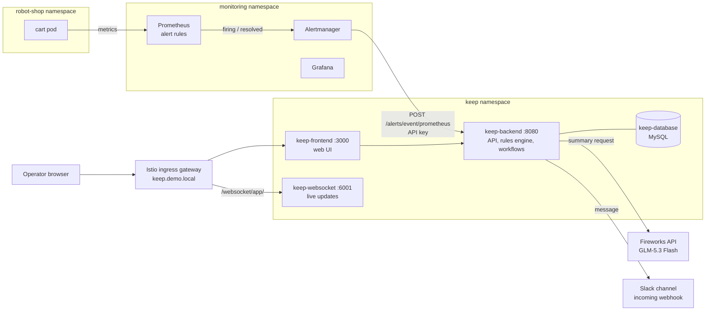
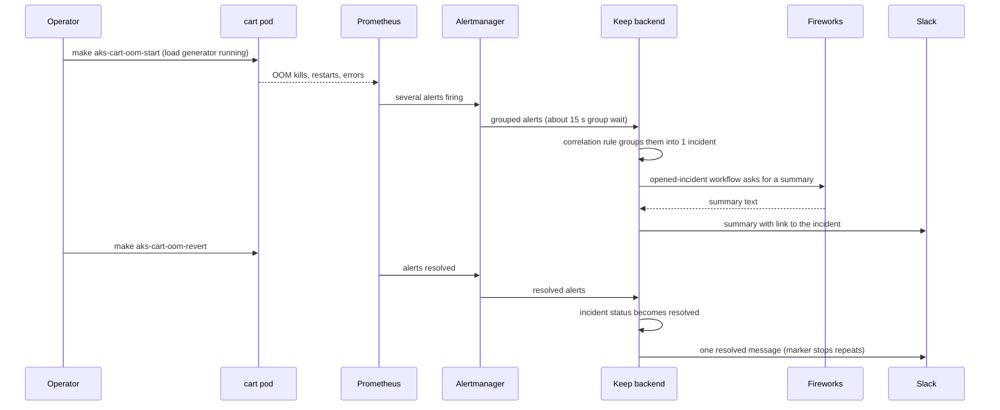

# Keep alert management: architecture

Epic: issue #91. Status: planned, nothing is built yet. Audience: the architect.

This page explains the whole design in one place. The binding decisions are
AD-008 to AD-013 in `docs/architectural-decisions.md`. The requirements are in
`_bmad-output/specs/spec-keep-alert-management/SPEC.md`. The stories are in
`_bmad-output/specs/spec-keep-alert-management/stories.yaml`. If this page and an
AD entry disagree, the AD entry wins.

## 1. What we are building

Today sre-stack shows that a fault happened: Prometheus, Grafana, Loki and Tempo
light up. Nothing happens after an alert fires. We add the next step:

1. A fault (for example, the cart pod runs out of memory) raises several alerts.
2. Keep groups them into one incident.
3. A language model (Fireworks, model GLM-5.3 Flash) writes a short summary.
4. The summary is posted to one Slack channel.
5. When the fault is fixed, the incident closes by itself and Slack gets one more
   message.

Keep is an open-source alert-management tool (keephq). We install it with its
Helm chart on AKS. A live try-out on AKS (research.md section 5) showed that every
part works. Section 9 lists what the try-out did not prove.

## 2. The big picture

Read it from the left. The cart pod fails, Prometheus evaluates the rules,
Alertmanager forwards the alerts to the Keep backend, and the backend does the
rest. The operator sees the result in the Keep UI through the Istio gateway and
in Slack.

## 3. One demo run, step by step

Timings seen in the try-out:

- The incident opened about 90 seconds after the fault started.
- The Slack summary must appear within 2 minutes of the incident opening.
- The incident resolved about 8 minutes after the revert, because the slowest
  alert (payment latency) clears last.

## 4. Components and where they run

| Component | Namespace | Node pool | Installed by | Story |
|---|---|---|---|---|
| Robot-shop alert rules (a PrometheusRule) | chosen in story 1 (Prometheus picks it up by the label `release: prometheus-stack`) | n/a | `kubectl apply` of `infra/azure/alert-rules/robot-shop.yaml` | 1 |
| Keep backend, frontend, websocket (Soketi), MySQL | `keep` | `workload=o11y` with the spot toleration (AD-003) | `make setup-keep` (Helm chart `keephq/keep` 0.1.97) | 2 |
| Alertmanager | `monitoring` | `workload=o11y` | `setup-aks-prometheus-stack` (AKS values layer only) | 3 |
| Correlation rule | inside Keep's database | n/a | script in `setup-keep`, `POST /rules` | 4 |
| Providers `fireworks` and `slack` | inside Keep | n/a | `KEEP_PROVIDERS` Secret built by `setup-keep` | 5a |
| Workflows (opened, resolved) | inside Keep | n/a | ConfigMap `sre-keep-workflows` mounted into the backend | 5a, 5b |
| Keep login | Keep backend and frontend | n/a | `AUTH_TYPE=DB` plus Secret `sre-keep-auth` | 6a |
| Gateway and VirtualService for `keep.demo.local` | `keep` | n/a | `kubectl apply` of `infra/azure/keep/istio-gateway.yaml` | 6b |

Everything is AKS-only. k3d and EKS get no Keep and must keep working.

## 5. Five ways Keep is configured (AD-011)

Keep offers no single way to load its configuration, so each kind of setting uses
the one path Keep supports for it:

| What | How it gets into Keep | Where it lives in the repo |
|---|---|---|
| Install settings (pins, node pool, storage, telemetry) | Helm values | `infra/azure/chart-values/keep.yaml` |
| Provider connections (Fireworks, Slack) | `KEEP_PROVIDERS` JSON in a Secret, built at install time from the secrets folder | `infra/azure/keep/providers.template.json` (no secrets) |
| Workflows | Keep workflow files in a ConfigMap, mounted into the backend, read at start | `infra/azure/keep/workflows/*.yaml` |
| Correlation rule | `POST /rules` (create) or `PUT /rules/{id}` (update) through a port-forward | `infra/azure/keep/correlation-rule.json` |
| API keys and login | Environment variables from Secrets | generated files in the secrets folder |

Keep reads providers, workflows and `KEEP_DEFAULT_API_KEYS` only when the backend
starts. So `setup-keep` restarts `keep-backend` when the content of the related
Secret or the workflows folder changes (decided by a hash). A run with nothing
changed restarts nothing.

## 6. Secrets (AD-008)

No secret value goes into `.env`, a values file, a manifest or a template. All
values live in one untracked folder on the operator machine. `.env` holds only the
folder location: `KEEP_SECRETS_DIR=$HOME/.secrets/keep`.

| File in the folder | Holds | Who creates it | First needed in story |
|---|---|---|---|
| `fireworks.key` | Fireworks API key | operator | 2 |
| `slack-webhook.url` | Slack incoming webhook | operator | 5a |
| `keep-webhook-api.key` | key Alertmanager sends to Keep | `setup-keep` (generated) | 3 |
| `setup-api.key` | key `setup-keep` uses for its own API calls | generated | 4 |
| `db-password` | MySQL root password | generated | 2 |
| `login-password`, `jwt-secret`, `nextauth-secret` | login values | generated | 6a |

Generated files are made once with `openssl rand -hex 24` (mode 600) and reused.

Kubernetes Secrets built from those files:

| Secret | Namespace | Holds | Story |
|---|---|---|---|
| `sre-keep-ai-env` | `keep` | Fireworks key | 2 |
| `sre-keep-db` | `keep` | database connection string and root password | 2 |
| `sre-keep-api-keys` | `keep` | `KEEP_DEFAULT_API_KEYS` | 3, 4 |
| `alertmanager-keep-auth` | `monitoring` | the webhook key, mounted for `password_file` | 3 |
| `sre-keep-providers` | `keep` | `KEEP_PROVIDERS` JSON | 5a |
| `sre-keep-auth` | `keep` | login password, JWT secret, NextAuth secret | 6a |

Rules to remember:

- Our Secrets are never named `keep-*`. The chart's uninstall hook deletes every
  Secret with that prefix. Ours use `sre-keep-`.
- A variable that comes from a Secret must not also appear in the chart's `env`
  list. An explicit `env` entry beats `envFrom`, so the real value would be
  ignored.
- Run on its own, `setup-keep` stops when a supplied file is missing and names it.
  Inside `make setup-aks`, it skips Keep with a message and the rest of the AKS
  setup finishes.

## 7. Login, API keys and address

### Login and API keys (AD-009, story 6a)

- `AUTH_TYPE=DB` (uppercase) turns on Keep's own login with one default user. The
  user name comes from `.env`. The password, JWT secret and NextAuth secret come
  from `sre-keep-auth`.
- `KEEP_FORCE_RESET_DEFAULT_PASSWORD=true` makes the `login-password` file the
  source of truth on every start.
- Two API keys are created at start-up through `KEEP_DEFAULT_API_KEYS`. Each is
  named after a fingerprint of its value, so a new value becomes a new key:
  - a `webhook` key (rights: write alerts and incidents) for Alertmanager;
  - an `admin` key for `setup-keep` (needed by `POST /rules`).
- The keys are created from story 3, while Keep still runs without a login
  (`NOAUTH`, which accepts any key). Every caller already sends the real key, so
  turning the login on in story 6a changes nothing for Alertmanager or the scripts.
- Story 6a is where the key checks become real: right key gives 202, wrong key
  gives 401.

### Address (AD-010, story 6b)

- The Keep UI and websocket are served at the root of `http://keep.demo.local`,
  through a Gateway and VirtualService in the `keep` namespace on the shared
  `istio: ingressgateway`. This is the same pattern as HotROD (AD-005).
- Routes: `/websocket/app/` goes to `keep-websocket:6001` with the prefix rewritten
  to `/app/`. Everything else goes to `keep-frontend:3000`. The backend has no
  route; the frontend proxies it.
- No sub-path such as `/keep`: the published frontend image has no `basePath`, and
  Next.js fixes it when the image is built.
- `NEXTAUTH_URL` is `http://localhost:3000` in story 6a (sign-in through a
  port-forward) and becomes `http://keep.demo.local` in story 6b, in the same pull
  request as the route.
- `setup-keep` applies the route only after it confirms that both backend and
  frontend run with `AUTH_TYPE=DB`.
- The operator adds one `/etc/hosts` line. `make get-service-endpoints` prints it.
  Plain HTTP is accepted for this demo stack.

## 8. Alertmanager and alert rules

### Alertmanager (AD-012, story 3)

- Turned on in `infra/azure/chart-values/prometheus-stack.yaml` (the AKS layer).
  The shared `monitoring/chart-values/prometheus-values.yaml` keeps it off, so EKS
  and k3d run no Alertmanager.
- Keep is the only receiver:
  `http://keep-backend.keep.svc.cluster.local:8080/alerts/event/prometheus`, basic
  auth with user `api_key`, password from a mounted file, `send_resolved: true`.
- Timings (they count against the 2-minute budget for the Slack summary):
  `group_by [alertname, namespace]`, `group_wait 15s`, `group_interval 1m`,
  `repeat_interval 1h`.
- `routes: []` is set explicitly because Helm merges maps.
- The broken Slack setting is removed from the shared values file.
- `setup-aks-prometheus-stack` creates the Secret `alertmanager-keep-auth` before
  its `helm upgrade`. A Secret listed in `alertmanagerSpec.secrets` is mounted as a
  volume, so a missing Secret would stop the Alertmanager pod from starting.
- One target owns the `prometheus-stack` release. `setup-keep` never upgrades it.

### Alert rules (story 1)

- Five rules for robot-shop: OOM kills, container restarts, unavailable replicas,
  slow requests (payment latency, threshold tuned) and a high share of 5xx.
- Metrics come from kube-state-metrics and Beyla
  (`http_server_request_duration_seconds`).
- Severity labels must use Keep's names: critical, error, high, warning, info. The
  repo's old `P1` would show as info.
- Rules carry `release: prometheus-stack` so Prometheus picks them up.

## 9. What is proven and what is not

Proven by the live try-out on AKS (research.md section 5):

- Alertmanager to Keep with the webhook, firing and resolved.
- A correlation rule grouping six alerts into one incident that resolves by itself.
- A workflow that gets a Fireworks summary into Slack in about 8 seconds.
- `max_tokens` 10000 is needed, because GLM-5.3 Flash thinks before it answers.

Not proven yet. Each is a live check inside a story, with a fallback or a stop rule:

| Open item | Story | If it fails |
|---|---|---|
| `KEEP_DEFAULT_API_KEYS` seeds keys as expected | 3 | fall back to `POST /settings/apikey` |
| `AUTH_TYPE=DB` login works and password reset works | 6a | stop, back to the spec |
| Narrow websocket route `/websocket/app/` carries live updates | 6b | route the whole `/websocket` prefix |
| Resolved message posts exactly once | 5b | stop, do not ship a version that posts more than once |
| Pinned MySQL honours `MYSQL_ROOT_PASSWORD_FILE`; hook image has a shell | 2 | pick another pinned image |
| Grafana digest-scheme contact point on Grafana 10 | 8 | write a new AD |
| `get_events` and the Role for events | 9 | record and stop |
| Loki ruler to Alertmanager in Monolithic mode | 10 | Grafana-managed alert as fallback |

## 10. Known limits we accept

- One shared login, no per-person accounts or roles.
- Plain HTTP for the Keep address.
- Keep leaves `end_time` empty on a resolved incident, so time-to-resolve may read
  zero. We do not fix Keep.
- A resolved incident that reopens keeps its "already notified" marker, so the
  second close posts nothing.
- Providers and workflows reload only when the backend restarts. Edits made in the
  Keep UI are overwritten at the next restart.
- Skipping Keep inside `make setup-aks` means a successful run no longer proves Keep
  is installed. Read its output.
- With Keep skipped, Alertmanager runs and logs failed deliveries until
  `setup-keep` runs.

## 11. Decisions at a glance

| ID | Decision | Main reason |
|---|---|---|
| AD-008 | All Keep secrets in one untracked folder; our own `sre-keep-*` Secrets built at install time | keeps secrets out of git; survives Keep's uninstall hook |
| AD-009 | DB login, one user, two seeded API keys named by fingerprint | `NOAUTH` makes every key admin; a fingerprint avoids a silent 401 after a key change |
| AD-010 | `keep.demo.local` on the shared ingress, extending AD-005 | no new load balancer; fixed login redirect address |
| AD-011 | Workflows as files, providers from a Secret, the rule by API | one supported path per kind of setting; no secret in the repo |
| AD-012 | Alertmanager on for AKS only, sending only to Keep | one notifier; AKS-only keeps EKS and k3d unchanged |
| AD-013 | One values file, every image pinned, a database password, telemetry off | repeatable installs; no data sent out; no passwordless database |

Each AD entry also lists the alternatives we rejected and what we gave up.

## 12. Build order

See `_bmad-output/specs/spec-keep-alert-management/delivery-slices.md` for the story
flow. In short: stories 1 and 2 first (in parallel), then 3, 4, 5a, 5b, 6a, 6b and
7 in a line. Stories 8 to 11 are lower priority and come after story 7.

## 13. Words used on this page

- **Alertmanager**: the Prometheus component that groups alerts and sends them on.
- **Correlation rule**: a Keep rule that groups alerts into one incident.
- **Incident**: a Keep record that holds a group of related alerts.
- **Workflow**: a Keep YAML file that runs steps when something happens, for
  example "an incident is created".
- **Provider**: Keep's name for a connection to an outside system.
- **Istio ingress gateway**: the shared entry point of the cluster.
- **Secret / ConfigMap**: Kubernetes objects that hold sensitive / non-sensitive
  settings.
- **Fingerprint**: the first 8 characters of a value's SHA-256 hash. It names a key
  without showing the key.
- **OOM kill**: Kubernetes stops a container that uses more memory than its limit.
- **NOAUTH**: Keep's default mode with no login, where any API key counts as admin.
